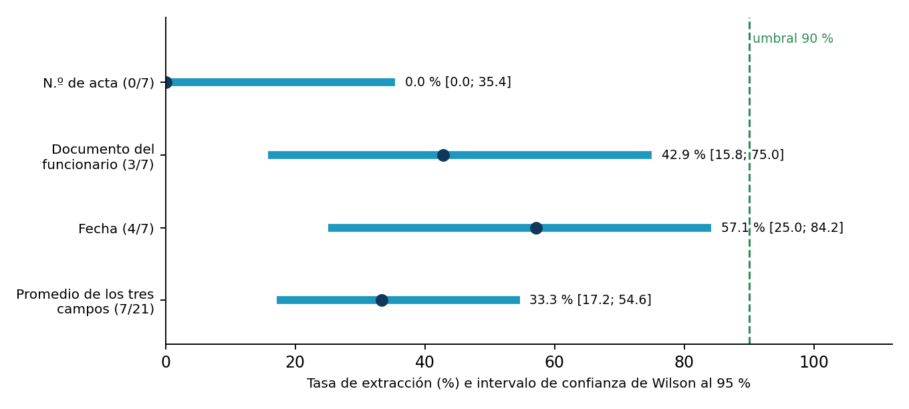
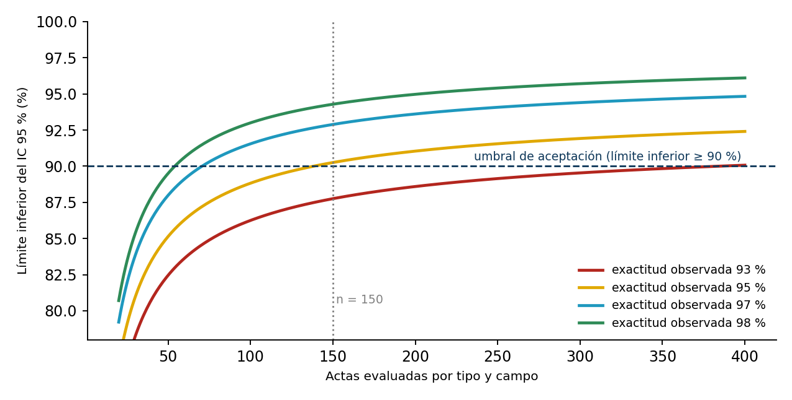

# Extracción automática de actas escaneadas — Foro Escenarios 5 y 6

Herramientas, dimensionamiento y documentación del estudio de caso **«Calidad de la extracción automática de actas
escaneadas en una entidad pública del orden nacional»** (Módulo *Metodología de Casos*, Maestría en Arquitectura de
Software, Politécnico Grancolombiano; docente: María Cruz).

El estudio pregunta **qué factores del documento, del método de extracción y de la forma de ejecución explican que un
prototipo de OCR no alcance la exactitud requerida en los campos críticos**, y propone dos soluciones con reglas de
decisión fijadas de antemano: **H1** (preprocesamiento y extracción por zonas) y **H2** (validación asistida por semáforo
con trazabilidad).

> ## ⚠️ Integridad y protección de datos
> - **Este repositorio no contiene datos reales**: ni actas, ni transcripciones, ni identificadores. Las actas incluyen datos
>   personales protegidos por la **Ley 1581 de 2012** y el análisis con datos reales debe hacerse **dentro de la
>   infraestructura de la Entidad**. `data/reales/`, `actas/` y las imágenes están en `.gitignore`.
> - **No hay resultados empíricos sobre el prototipo.** Las únicas cifras del caso son las del piloto de 7 actas y las del
>   universo (5.082 actas). Lo demás es **dimensionamiento** con supuestos rotulados: planea la medición, no predice su resultado.
> - Los entregables institucionales (Word/PDF con la plantilla del Politécnico) **no se versionan** (propiedad intelectual de la
>   institución); viven en `entregables/`, ignorado por git.

## El caso en cifras
| Indicador | Valor | Fuente |
|---|---|---|
| Universo | 5.082 actas (3 tipos × 1.694), sin capa de texto, 29–35 variables por acta | Caso |
| Completitud del piloto (n = 7) | 85 % | Caso |
| Extracción de campos críticos (piloto) | N.º de acta 0/7; documento del funcionario 3/7; fecha 4/7 | Caso |
| Promedio de los tres campos críticos | 33,3 % (7/21) | Cálculo propio |
| Ciclo de validación manual | ≈ 8 semanas (1 líder + 4 técnicos) | Estimación de la Entidad |
| Validaciones con trazabilidad | 0 % | Caso |

**Idea central:** el prototipo mide si un campo *tiene valor*, no si el valor *es correcto*. Sin una medida de **exactitud**
contra un conjunto de referencia no se puede saber si sirve.

## Qué contiene
```
src/extraccion_actas/
  estadistica.py   # IC de Wilson, tamaños de muestra (estimación, aceptación, McNemar, tiempo, error residual)
  evaluacion.py    # exactitud por tipo/campo, McNemar pareado, decisión H1/H2, calibración de umbrales
  figuras.py       # figuras del dimensionamiento
  cli.py           # python -m extraccion_actas  -> reports/
tests/             # 29 pruebas (cifras del documento, reglas de decisión, calibración)
data/plantillas/   # esquema del registro de evaluación (sin datos)
docs/              # publicación del foro, reglas de decisión, arquitectura, instrumentos
reports/           # dimensionamiento.json y figuras generadas
```

## Inicio rápido
```bash
python -m venv .venv && source .venv/bin/activate     # Windows: .venv\Scripts\activate
pip install -e ".[dev]"
pytest                          # 29 pruebas
ruff check src tests
python -m extraccion_actas      # regenera reports/dimensionamiento.json y las figuras
```

## Resultados del dimensionamiento
**Hallazgo principal:** *demostrar que el método nuevo mejora es barato; demostrar que alcanza el 90 % es caro.*

| Pregunta | Resultado |
|---|---|
| Piloto (n = 7): ¿alcanza el 90 %? | Ningún intervalo de Wilson llega al 90 % (el más alto: 84,2 % en la fecha); pero la magnitud real es incierta (documento del funcionario: 15,8 %–75,0 %) |
| Actas para detectar la mejora de H1 (McNemar, potencia 0,80) | Entre 16 y 85, según la exactitud de la v1.0 |
| Actas por tipo y campo para sostener que se supera el 90 % | 139 si la exactitud observada es 95 %; 71 si es 97 %; **385 si es 93 %** |
| Diseño propuesto | **150 actas por tipo (450 en total, 8,9 % del universo)**: acepta una versión de ≥ 95 % y declara insuficiente la muestra si queda en torno a 93 % |
| Actas para el tiempo de revisión de H2 (prueba t pareada) | 34 con efecto mediano (d = 0,5); 15 con efecto grande (d = 0,8) |
| Campos para acotar el error sin corregir por debajo de 2 % | 335 si se observa 0,5 %; 753 si se observa 1 % (se dispone de 1.350) |
| Esfuerzo de la referencia (**supuesto**: 6 min/acta/persona) | ≈ 90 h de doble transcripción (≈ 2,25 semanas de una persona) |
| Ciclo actual (**supuesto**: dedicación completa) | ≈ 19 min por acta (1.600 h) |




## Uso con datos reales (dentro de la Entidad)
```python
import pandas as pd
from extraccion_actas import evaluacion as V

df = pd.read_csv("data/reales/registro_evaluacion.csv", dtype=str).assign(confianza=lambda d: d.confianza.astype(float))
print(V.exactitud_por_grupo(V.con_exactitud(df)))            # exactitud + IC de Wilson por tipo y campo
print(V.mcnemar_pareado(df, base="v1.0", nueva="nueva"))     # mismas actas, dos versiones
print(V.decision_h1(df, base="v1.0", nueva="nueva"))         # SOSTENIDA / PARCIAL / DESCARTADA
sub = V.con_exactitud(df).query("version == 'nueva' and campo == 'n_acta'")
print(V.calibrar_umbral(sub.confianza, sub.exacto, cobertura=0.80))   # calibrar con datos; validar en actas retenidas
```
Reglas completas en [`docs/02_reglas_de_decision.md`](docs/02_reglas_de_decision.md).

## Limitaciones
- No hay mediciones sobre el prototipo; el piloto es de 7 actas de un solo tipo.
- Los umbrales (90 % de exactitud; 2 % de error sin corregir) no están acordados con la Entidad.
- Los minutos por acta y el esfuerzo de transcripción son **supuestos**.
- Los cálculos suponen observaciones independientes; los campos de una misma acta están correlacionados y los intervalos
  reales podrían ser algo más anchos.
- Un solo sitio: no se generaliza a otras entidades.

## Referencias principales
Paleyes et al. (2022), *ACM Computing Surveys* (https://doi.org/10.1145/3533378) · Memon et al. (2020), *IEEE Access*
(https://doi.org/10.1109/ACCESS.2020.3012542) · Documentación de Tesseract OCR, *Improving the quality of the output* ·
Filcik y Murphy (2026), Microsoft Foundry Blog · Connor (1987), *Biometrics* · Wilson (1927), *JASA*.

## Autoría y uso de IA
Autor: **Alejandro de Mendoza Tovar**. Se usó una herramienta de IA generativa como apoyo para estructurar, redactar, verificar
referencias y programar el dimensionamiento; el autor revisó el contenido y asume la responsabilidad por él.

## Licencia
Código bajo licencia MIT (ver `LICENSE`). La licencia no cubre datos, actas ni materiales institucionales.
