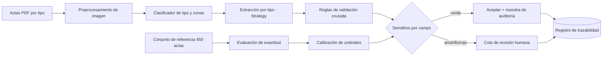

# Arquitectura de referencia

## Decisiones (ADR)
| ADR | Decisión | Justificación |
|---|---|---|
| 001 | Arquitectura por capas con patrón Strategy por tipo de acta | Tres formatos con variables propias |
| 002 | Evaluar contra un conjunto de referencia antes de operar | Ninguna versión se ha evaluado contra actas validadas; completitud ≠ exactitud |
| 003 | Semáforo **por campo** con umbrales calibrados y versionados | Un semáforo por acta oculta errores en campos críticos |
| 004 | Registro de trazabilidad de solo adición | Hoy 0 % de validaciones trazables |
| 005 | Procesar dentro de la infraestructura de la Entidad | Datos personales (Ley 1581 de 2012) |

Más detalle y figuras: `reports/figures/f1_arbol.png`, `f2_arquitectura.png`, `f3_flujo.png`.
